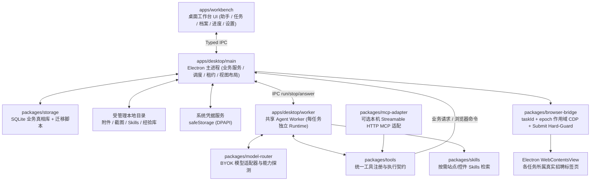

# JobHelper

**本地优先（Local-First）、BYOK（自带模型 API）、人机协同的桌面端网申投递助手。**

用户配置自己的模型 API、选定一份简历档案、粘贴岗位链接，即可在桌面窗口中实时看见助手观察并填写招聘网页，并在需要登录、处理验证码、补充未知事实或执行最终提交时随时接管与授权。

> **当前阶段：M0 — 架构框架、契约定义与总控 Checklist 已搭建完成，尚未进入功能编码。**

---

## 核心设计原则

1. **双角色协作（Coordinator + Application）**：一个常驻总助手负责整理档案、拆解需求、派发任务与追踪进度（无浏览器写权）；每个岗位独立生成一个投递任务，拥有独立对话历史、任务级标签页集合和锁定档案快照。
2. **本地主进程掌握唯一真相（Local SoT）**：去掉平台账号、套餐计费、云浏览器与远端镜像双写。SQLite 保存业务实体与有序事件，系统凭据服务（Electron `safeStorage` / Windows DPAPI）托管模型密钥，受管理本地目录存放附件、截图与版本化 Skills。
3. **轮次租约隔离（`taskId + epoch` Fencing）**：每一轮执行签发独立 `epoch`。用户点击“我来操作”时，先撤销租约与任务级 CDP 连接，再把原生招聘网页交给人，杜绝迟到的旧动作打断用户操作。
4. **四轴分离状态模型**：严格区分 `executionState`（运行状态）、`waitingReason`（等待原因）、`applicationStage`（表单阶段）、`outcome`（投递结果），绝不把“本轮结束”或“主要内容已填完”误判为“已投递”。
5. **浏览器执行层硬闸门（Submit Hard-Guard）**：首版最终提交默认由用户在右侧真实网页确认完成；任何可触发提交的途径（`act` 点击、`Enter` 键、坐标点击、受限脚本执行）都在执行层统一受控。

---

## 系统架构总览



---

## 仓库目录结构

```text
jobhelper/
├── docs/                           # 架构规格、Checklist、工具契约、数据库设计、Gate 1 验收与 ADR
│   ├── ARCHITECTURE.md             # 完整系统架构与运行协议规格
│   ├── CHECKLIST.md                # M0–M6 总控实施 Checklist 与阶段门禁
│   ├── TOOL_CONTRACTS.md           # 协调助手与投递助手统一工具契约
│   ├── DATABASE_SCHEMA.md          # SQLite 表结构与数据归属设计
│   ├── ACCEPTANCE_GATE1.md         # Gate 1 黄金闭环与安全边界验收方案
│   └── ADR/                        # 关键架构决策记录 (0001–0004)
├── packages/
│   ├── contracts/                  # @jobhelper/contracts — 纯类型、ID、四轴状态、IPC/事件 DTO
│   ├── storage/                    # @jobhelper/storage — SQLite 迁移脚本与 Repository 接口
│   ├── core/                       # @jobhelper/core — Task/Profile/Confirmation/Scheduler/ControlLease 服务契约
│   ├── model-router/               # @jobhelper/model-router — BYOK 模型提供方适配、能力探测与密钥接口
│   ├── browser-bridge/             # @jobhelper/browser-bridge — 任务作用域 CDP、Ref 失效与 Submit Hard-Guard 契约
│   ├── tools/                      # @jobhelper/tools — 内置 Runtime 与 MCP 共用的统一工具注册层
│   ├── skills/                     # @jobhelper/skills — 按需站点/控件 Skills 索引与加载契约
│   ├── runtime/                    # @jobhelper/runtime — 任务 Agent 循环、上下文裁剪与问答等待契约
│   └── mcp-adapter/                # @jobhelper/mcp-adapter — 可选本机任务级 MCP 适配层
├── apps/
│   ├── desktop/                    # Electron 主进程、Preload 桥与共享 Agent Worker 宿主骨架
│   └── workbench/                  # 桌面工作台前端 UI 骨架
├── skills-library/                 # 受管理的本地 Skills 知识库目录结构（ATS / 通用控件 / 本地草稿）
├── fixtures/
│   └── mock-ats/                   # Gate 1 可重置本地测试表单与验收夹具规划
├── AGENTS.md                       # Git 提交、分支合入与阶段验收规范（强制执行）
├── GEMINI.md                       # Gemini / Antigravity 协作规则引用
└── 主代理交接-锦鲤架构与本地投递助手.md  # 原始调查与架构交接输入文档
```

---

## 文档阅读导航

1. 架构背景与交接输入：[主代理交接-锦鲤架构与本地投递助手.md](./主代理交接-锦鲤架构与本地投递助手.md)
2. 系统架构与运行协议：[docs/ARCHITECTURE.md](./docs/ARCHITECTURE.md)
3. **总控 Checklist 与阶段门禁**：[docs/CHECKLIST.md](./docs/CHECKLIST.md)
4. 工具契约清单：[docs/TOOL_CONTRACTS.md](./docs/TOOL_CONTRACTS.md)
5. 数据库与持久化设计：[docs/DATABASE_SCHEMA.md](./docs/DATABASE_SCHEMA.md)
6. Gate 1 验收方案：[docs/ACCEPTANCE_GATE1.md](./docs/ACCEPTANCE_GATE1.md)
7. 架构决策记录：[docs/ADR/](./docs/ADR/)
8. Git 提交与合入规范：[AGENTS.md](./AGENTS.md)
