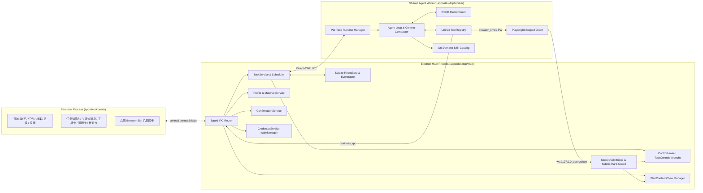

# JobHelper 系统架构与运行协议规格（v0.1）

> 本文档在 [主代理交接-锦鲤架构与本地投递助手.md](../主代理交接-锦鲤架构与本地投递助手.md) 及对应静态调查报告的基础上，确定 JobHelper 的工程架构、进程职责、状态模型、身份协议、安全边界与异常恢复语义。

---

## 1. 产品范围与设计目标

### 1.1 第一版核心范围（MVP / Gate 1 → M6）
- **BYOK 本地直连**：用户配置任意兼容模型服务（OpenAI-compatible / Anthropic / Gemini / DeepSeek / Ollama 等），密钥存于本机系统凭据服务，请求直连用户选定端点。
- **双角色助手模型**：
  - **总助手（`coordinator`）**：维护长期对话，读取/编辑档案与材料，记录岗位进度，派发单个或多个投递任务，查询任务状态；**禁止直接操作招聘网页**。
  - **投递助手（`application`）**：每个岗位一个独立任务、独立对话历史、独立档案版本快照、独立任务级浏览器标签集合；**禁止派生其他岗位任务或越权访问其他任务页面**。
- **人机协同可见浏览器**：在桌面窗口内以 `Electron WebContentsView` 嵌入真实招聘页面。Agent 运行期间展示状态/预览或只读观测，用户接管后立即切为可交互原生网页；顶栏持续明确显示当前控制者（`agent` / `stopping` / `human`）。
- **可控的 Computer Use 范围**：v1 严格限定在任务所属招聘浏览器内（观察、点击、输入、滚动、下拉、附件上传、页面截图、人工接管）。跨应用操作与 Windows 原生桌面鼠键驱动留作后续独立扩展能力，且不得迫使普通网页操作占用系统鼠标。

### 1.2 明确不做的事项（相对于商业参考对象）
- **删除**：平台账号注册/登录、套餐额度/扣次/支付网关、云端浏览器容器/远程桌面串流、官方模型代理与结算、强制云端录屏/trace/Cookie 上传。
- **本地接替**：任务登记与去重、四轴状态持久化、档案与附件绑定、待办与问题卡、最终核对与授权卡、本地版本化 Skills 与站点经验库、动作审计账本。
- **后置为可选数据源能力**：全网岗位大厅、算法推荐、小红书/公众号调研、自动验证码求解。v1 遇到登录与验证码统一通过人工接管处理。

---

## 2. 进程拓扑与组件边界

### 2.1 组件职责硬边界

| 组件 | 所在包 | 必须负责的事 | 严禁混入的职责 |
|---|---|---|---|
| **Contracts** | `@jobhelper/contracts` | 所有跨进程 DTO、ID 类型、四轴状态定义、IPC 协议、事件类型 | 任何运行时 I/O、Electron/Node 专属实现 |
| **Storage** | `@jobhelper/storage` | SQLite 迁移、事务读写、有序事件落盘、动作账本、乐观锁/去重 | 业务状态机推断或 UI 展示拼接 |
| **Core Services** | `@jobhelper/core` | 原子创建/去重、四轴状态转换、`ControlLease`、队列调度、档案快照绑定、核对授权消费 | 直接调用大模型或直接操作 DOM |
| **Model Router** | `@jobhelper/model-router` | BYOK Provider 适配、能力探测、流式协议归一化、超时/取消、usage 统计 | 密钥明文落库、把密钥暴露给渲染层或招聘网页 |
| **Browser Bridge** | `@jobhelper/browser-bridge` | 任务级 `ScopedCdpBridge`、`WebContentsView` 管理、AXTree/Ref 失效、Submit Hard-Guard | 跨任务访问标签页、允许未授权限绕过提交闸门 |
| **Tool Registry** | `@jobhelper/tools` | 单一工具 schema 与执行入口；按角色 (`coordinator`/`application`) 隔离可见工具 | 为内置 Runtime 与外部 MCP 维护两套实现 |
| **Skills Catalog** | `@jobhelper/skills` | 站点/控件 Skill 索引、按 URL/DOM 特征推荐、按需读取正文、本地草稿管理 | 每轮把全部 32+ 份 Skill 正文全量塞入上下文 |
| **Agent Runtime** | `@jobhelper/runtime` | Observe→Plan→Act→Verify 循环、上下文裁剪、问题等待 (`callId`)、暂停收束 | 自行修改数据库业务状态或绕过主进程执行权 |
| **MCP Adapter** | `@jobhelper/mcp-adapter` | 可选本机 Streamable HTTP MCP 入口（随机端口 + token + task 路由），复用 `@jobhelper/tools` | 独立维护任务状态或替代调度器 |

---

## 3. 身份与关联 ID 协议（禁止混用）

| ID | 类型 | 生命周期与语义 | 约束 |
|---|---|---|---|
| `taskId` | UUID | 一个岗位投递任务或总助手会话的永久主键 | 暂停、继续、重启均不变；同未完成岗位重复发起必须复用 |
| `runId` | UUID | 单次调度轮次的执行记录 ID | 每次进入 `running` 新建；绑定模型配置快照、usage 与 `endReason` |
| `epoch` | UUID | 单轮执行权租约令牌（`ControlLease.acquire` 生成） | 停止或轮次结束立即失效；一切有副作用的浏览器/业务动作必须携带并校验 |
| `sessionId` | String | 模型对话上下文标识（如 `application-<taskId>`） | 跨轮次延续模型上下文；不替代数据库业务状态，也不作为执行权令牌 |
| `callId` | String | 模型发出的单次 tool call 标识 | 配对 `tool_call`/`tool_result` 与 `ask_user_question` 的挂起等待者 |
| `questionId` | UUID | 问题卡内每个独立问题的稳定 ID | 验证用户回答与选项，支持迟到回答回挂原问题 |
| `confirmationId` | UUID | 一次核对卡/操作确认卡的唯一 ID | 绑定 `taskId + operation + contentHash + expiresAt`；消费或内容变更后失效 |
| `clientMessageId` | UUID | UI 发送用户消息的客户端幂等键 | 防止连点或重连导致消息重复入队 |
| `profileVersionId` | UUID | 档案不可变版本快照 ID | 投递任务创建时锁定；切换全局默认档案不影响已有任务 |
| `positionId` | UUID | 本地求职进度表中的岗位记录主键 | 与外部招聘站点 URL / 外部 jobId 解耦 |
| `browserProfileId` | String | 招聘浏览器登录分区标识（对应 Electron `persist:jobhelper-<id>`） | 同一身份下多任务共享网站登录态；多账号时显式切换分区 |

---

## 4. 四轴分离状态模型

彻底抛弃单一 `status` 字段。每个 `application` 任务在数据库中独立持久化四条正交轴：

### 4.1 四条轴定义

1. **`executionState`（运行状态）**：
   `draft` | `queued` | `running` | `stopping` | `paused` | `waiting_user` | `interrupted` | `error` | `closed`
2. **`waitingReason`（等待原因）**：
   `none` | `login` | `captcha` | `missing_info` | `manual_control` | `submission_confirmation` | `manual_submit` | `result_check`
3. **`applicationStage`（表单阶段）**：
   `created` | `opened` | `inspecting` | `filling` | `filling_ready` | `submit_attempted` | `verifying` | `done`
4. **`outcome`（投递结果）**：
   `not_submitted` | `unknown` | `submitted_verified` | `user_reported` | `job_unavailable` | `closed_without_submit`

### 4.2 典型场景的四轴组合示例

| 真实场景 | `executionState` | `waitingReason` | `applicationStage` | `outcome` |
|---|---|---|---|---|
| 刚打开北森登录页，助手只读观察后请求登录 | `waiting_user` | `login` | `opened` | `not_submitted` |
| 助手填表时发现缺少“本科 GPA”，弹出问题卡 | `waiting_user` | `missing_info` | `filling` | `not_submitted` |
| 用户中途点击“我来操作”，等待旧动作收束 | `stopping` → `paused` | `manual_control` | `filling` | `not_submitted` |
| 所有主要字段已填完并回读核对，展示核对卡 | `waiting_user` | `submission_confirmation` | `filling_ready` | `not_submitted` |
| 用户决定直接在右侧网页点提交（首版默认） | `waiting_user` | `manual_submit` | `filling_ready` | `not_submitted` |
| 点击提交后官网超时未返回回执 / 应用意外重启 | `waiting_user` | `result_check` | `verifying` | `unknown` |
| 读取到官网“投递成功 / 已收到申请”回执 | `closed` | `none` | `done` | `submitted_verified` |
| 用户在弹窗中明确确认“我已在官网完成提交” | `closed` | `none` | `done` | `user_reported` |

### 4.3 硬性状态不变量
- **单轮结束 ≠ 投递成功**：`run.endReason === 'completed'` 仅结束该 `run`，绝不自动推进 `outcome`。
- **结构化信号驱动 `waiting_user`**：只有持久化的 `todo` / `question` / `confirmation` / `manual_submit` 才把任务转入 `waiting_user`，禁止靠解析助手自然语言（如“请你登录”）猜测状态。
- **修改即失效确认**：任务表单内容变更、附件清单变更或用户接管后修改字段，立即使既有 `pending`/`approved` 确认卡失效（`contentHash` 失配）。
- **已尝试提交禁自动重放**：一旦 `applicationStage >= submit_attempted` 且 `outcome === 'unknown'`，重启、超时或网络重试只能进入只读核验，严禁再次自动点击提交。

---

## 5. 浏览器隔离、Ref 生命周期与 Submit Hard-Guard

### 5.1 任务级 Scoped CDP 与视图隔离
- **绝不开启 Chromium 全局 `--remote-debugging-port`**。
- 每个任务维护属于自己的 `WebContentsView` 列表；主进程 `ScopedCdpBridge` 监听本机随机端口，按 `ws://127.0.0.1:<port>/<ephemeralToken>` 分发连接，并在**每一条 CDP 消息入口与返回前**校验 `TaskControls.assert(taskId, epoch)`。
- 隐藏视图截图参考已验证策略：按需同步视图尺寸/DPR 归一化，且不影响用户当前正在浏览的其他任务标签页。
- 附件上传 WebSocket 帧上限预留 `80 MiB`（防止多份 PDF/证书 base64 超过默认 16 MiB 导致连接断开）。
- 新弹窗（`setWindowOpenHandler`）归入同一 `taskId`，在首次完成导航前不暴露给 Playwright，防止 `connectOverCDP` 卡死。

### 5.2 观察-消歧-动作-回读闭环（Ref Fencing）
- 每次 `observe` 递增页面 `generation` 并分配短生命周期 `ref`（如 `tab1:e3_12`）。
- 发生主帧导航、DOM 变更动作、调试器分离或 `epoch` 失效时，立即清空 `refs` 并递增 `generation`。
- 写入类操作（`fill` / `select` / `upload`）执行后必须立刻读回实际值并比对，不一致则报告明确错误并要求重新 `observe`。
- 密码框、短信验证码、OTP、图形验证码输入框在执行层硬拒绝自动填充，引导生成人工待办。

### 5.3 Submit Hard-Guard（全路径提交闸门）
仅给名为 `submit` 的工具加确认框远远不够。JobHelper 在 `@jobhelper/browser-bridge` 统一拦截**所有**可能触发表单提交的执行路径：

| 潜在触发路径 | 硬闸门策略（v1 默认：人工最终提交模式） | 可选授权模式（v1.1+ 批准后单次点击） |
|---|---|---|
| `act(click, ref)` | 校验目标元素文本、`aria-label`、`type="submit"`、所属 `<form>` 提交语义；命中则硬拒绝并要求走核对卡 | 必须通过 `ConfirmationService.assertValid(taskId, confirmationId, contentHash)` 且本轮仅允许消费 1 次 |
| `act(press, 'Enter')` | 焦点位于表单控件或任意可能隐式触发 submit 的场景下，执行层硬拒绝 `Enter` 键 | 仅允许在明确白名单非提交控件（如搜索下拉过滤且非表单 submit）或显式确认后使用 |
| 坐标点击（视觉定位） | 点击前通过 `document.elementFromPoint(x, y)` 解析真实命中元素并复用同一套提交语义检查；跨 iframe 命中直接转人工 | 同上，且点击前必须二次校验元素稳定性 |
| `run`（页面脚本） | **v1 默认禁用任意 JS 写入/提交**；只允许声明式只读探针或受控控件适配器；严禁通过 `page.evaluate` 调用 `.submit()` / `.click()` 绕过闸门 | 若后续开放受限 `run`，必须仅限受审阅的站点控件原语且禁止提交选择器 |
| 无法判定效果的按钮 | 按钮文案模糊（如“下一步 / 完成 / 确认”）且无法判定是否最终提交时，**宁可停下来展示核对卡或转人工，绝不冒险点击** | 同左 |

---

## 6. BYOK 模型路由与上下文管理

### 6.1 模型配置与能力探测
用户可配置多个 Provider Profile（例如“主力强推理 + 视觉模型”、“备用 OpenAI-compatible 端点”、“本地 Ollama”）：
- 配置字段：`providerType`（`openai-compatible` / `anthropic` / `gemini`）、`baseUrl`、`modelId`、`apiKeyRef`（仅存凭据键名，明文由 `safeStorage` 托管）、`timeoutMs`、`maxContextTokens`、`customHeaders`。
- **强制连通性 & 能力探测**：保存或切换前测试 `streaming`、`tool_calling`、`vision`（图像输入）三项能力并持久化探测结果。
  - 无 `tool_calling` 的模型不能用于投递 Agent。
  - 无 `vision` 的模型自动降级为纯 AXTree/DOM 文本流，遇到非标准视觉控件时更早转人工。
- **配置快照冻结**：每一轮 `run` 启动时冻结本轮模型配置快照；运行中途修改全局模型设置仅影响下一轮，不破坏当前轮审计。

### 6.2 上下文裁剪与按需 Skills 加载
- **分层记忆**：
  1. **系统指令 + 角色边界**（固定精简）
  2. **任务工作记忆（Working Memory）**：绑定岗位信息、锁定档案摘要、已确认事实、当前表单填写账本（已填字段/失败字段/缺失项）、未解决待办
  3. **已加载 Skills**：按需加载，最多保持当前站点 Skill（如 `ats-beisen`）+ 1~2 份当前遇到的通用控件 Skill（如 `form-dates`），禁止一次性注入全部 32 份 Skill
  4. **最近 N 轮工具轨迹**：裁剪陈旧的 `observe` 大快照和历史截图，只保留最近 1–2 次页面观察摘要与尚未核验的动作结果
- **数据安全声明**：BYOK 模式下发送到外部模型服务商的字段与页面截图会离开本机；在设置页显式提示用户，并对密码/敏感字段在观测层强制脱敏（如 `[密码]`）。

---

## 7. 关键交互时序与崩溃恢复语义

### 7.1 用户主动接管与恢复
1. 用户点击「我来操作」（或在招聘页手动导航/刷新/前进后退）：
2. 主进程将任务置为 `stopping`，**立即**调用 `TaskControls.stop(taskId)` 与 `ScopedCdpBridge.revoke(taskId)`，清空 pending 队列，向 worker 发送 `stop`。
3. Worker 终止当前推理请求与 Playwright 连接，清理挂起 IPC，返回 `stopped_ack`。
4. 主进程将任务切为 `paused` + `waitingReason=manual_control`，展示原生可交互 `WebContentsView`。
5. 用户在网页直接操作后点击「已处理，请检查」：
6. 主进程签发新 `runId` 与新 `epoch`，注入固定指令（请求先 `observe` 检查页面最新状态），入队执行。**按钮本身绝不代表登录或提交成功**。

### 7.2 问题卡与迟到回答
- Agent 调用 `ask_user_question` 生成带 `callId` 与 `questionId[]` 的持久化问题卡。
- 若在等待窗口内（默认 120s，可配置）用户提交回答，直接作为该 `callId` 的 `tool_result` 返回给当前轮。
- 若等待超时：问题卡保持 `pending`（绝不视为跳过或同意），当前轮可转入 `waiting_user(missing_info)`。用户稍后回答时，答案绑定原 `questionId`/`callId` 持久化，并以结构化补答进入下一轮，**不会丢失也不会重复发问**。
- 每个事实补答提供明确选项：“仅用于本次投递” 或 “同时写回个人档案/事实库”。

### 7.3 进程崩溃、API 超时与重启恢复
- **SQLite 先提交，再驱动 UI/Worker**：事件和动作账本记录 `pending → dispatched → observed / unknown`。
- **应用重启**：扫描上次处于 `running` / `queued` / `stopping` 的任务，全部置为 `interrupted`（`epoch = null`），保留历史消息、待办、核对卡与动作账本，提示“上次执行中断，请核对当前网页后继续”；**绝不自动重放任何旧写操作或提交动作**。
- **Worker 崩溃**：主进程立即撤销全部在途任务的 lease 与 CDP，将运行中任务标为 `error`，自动重启干净 Worker 实例供用户核对后手动继续。
- **渲染器（单个招聘网页）崩溃**：仅停止对应任务并标记需刷新页面，不影响总助手及其他并行投递任务。

---

## 8. 桌面工作台信息架构（UI Layout）

统一单套导航，消除双侧栏与“云桌面”概念混淆：

| 导航页 | 核心职责 | 关键交互 |
|---|---|---|
| **助手（Assistant）** | 总助手对话、当前默认档案切换、派出的投递任务状态卡 | 粘贴单条/多条岗位链接、讨论资料、一键派发、点击任务卡跳转详情 |
| **投递任务（Tasks）** | 筛选视图（全部 / 排队 / 执行中 / 待我处理 / 已结束）+ 直接粘贴 URL 快速创建入口 | 展示岗位、锁定档案版本、四轴状态徽章、等待原因；支持查看/接管/继续/关闭 |
| **任务详情（Task Detail）** | **顶栏**（岗位标题、锁定档案、四轴状态、当前控制者指示器、`我来操作`/`已处理，请检查` 主按钮）+ **左栏**（对话流、可展开工具步骤卡、问题卡、核对卡）+ **右栏**（真实原生 `WebContentsView`） | 左右分栏可拖拽调整，几何矩形同步至主进程控制原生视图；支持拆出独立浏览器窗口（拆出前先暂停 Agent） |
| **档案与材料（Profiles）** | 多版本结构化档案、事实记忆库、PDF 简历与附件材料管理 | 导入/编辑档案、查看版本快照、设置全局默认档案与附件 |
| **求职进度（Tracker）** | 本地岗位跟踪表（待投递 / 填写中 / 待核验 / 已投递 / 面试中 / 已结束） | 关联投递任务、区分官网回执与人工报告、手动维护面试后续进展 |
| **设置与技能（Settings）** | BYOK 模型服务商配置与连通性测试、并发上限（1–5）、浏览器身份分区、本地 Skills 与经验库审阅 | 测试模型能力、导入/启用/审阅 Skills、导出本地脱敏排错日志 |
