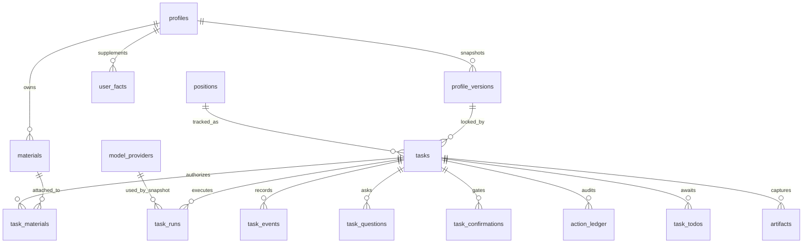

# JobHelper 本地数据库与持久化设计（v0.1）

> 对应迁移蓝图：[0001_initial.sql](../packages/storage/migrations/0001_initial.sql) · Repository 接口：[repositories.ts](../packages/storage/src/repositories.ts)

---

## 1. 存储分层原则

| 存储介质 | 存放内容 | 设计理由 |
|---|---|---|
| **SQLite（单一业务真相库）** | 任务、四轴状态、运行轮次、有序事件流、问题卡、核对授权卡、动作审计账本、档案与版本快照、材料元数据、岗位进度、BYOK 模型配置（无明文密钥）、本地站点经验 | ACID 事务、原子更新、重启可精确恢复、彻底告别 `tasks.json` 150 条截断与远端双写漂移 |
| **系统凭据服务（Electron `safeStorage` / Windows DPAPI）** | 模型服务商 API Key 密文 | 密钥与业务数据库物理隔离；前端不可读明文；支持用户导出脱敏 SQLite/日志排错 |
| **受管理本地目录（`userData/`）** | `materials/`（原始简历与证书附件）、`artifacts/<taskId>/`（截图、超长观察 spill 文件）、`skills/`（版本化 Skills 与本地草稿）、`browser-profiles/<profileId>/`（Electron session partition） | 大体积二进制文件不塞进 SQLite；按内容 SHA-256 与 `taskId` 归档，可随时清理或导出 |

---

## 2. 实体关系图（ER Overview）

---

## 3. 核心表职责与关键不变量

1. **`profiles` & `profile_versions`**：
   - `profiles` 保存可编辑的当前档案头信息及 `active_version_id`。
   - 每次修改档案或创建投递任务时，若内容变化则生成不可变的 `profile_versions` 快照（含 `content_json` 与 `content_sha256`）。
   - `tasks.profile_version_id` 外键锁定某一具体快照；切换全局默认档案仅更新 `app_preferences`，绝不改写既有任务。
2. **`tasks`（四轴状态主键表）**：
   - 同时承载 `coordinator`（总助手会话）和 `application`（独立投递任务）。
   - 严格通过 `CHECK` 约束限定 `execution_state`、`waiting_reason`、`application_stage`、`outcome` 合法枚举值。
   - 通过 `origin_conversation_id` 关联总助手与派出的投递任务；通过 `normalized_apply_url` 支持未完成任务的幂等去重查询。
3. **`task_runs`**：
   - 记录每一轮调度（`run_id`、`epoch`、冻结的 `provider_snapshot_json`、`end_reason`、token `usage_json`、`error_code`）。
   - 单轮 `end_reason` 独立于 `tasks.outcome`。
4. **`task_events`（有序事件真相流）**：
   - `(task_id, seq)` 全局单调递增，取代易截断的 150 条消息数组。
   - 覆盖 `user_message`（带 `client_message_id` 唯一索引防重发）、`assistant_message`、`tool_call`、`tool_result`、`status_transition`、`todo_event`、`question_event`、`confirmation_event`、`system_notice`。
5. **`task_questions`**：
   - 以 `call_id` + `question_id` 精确配对模型提问与用户回答；超时后 `status = 'pending'`，迟到回答通过 `answered_at` 与 `reply_injected_run_id` 追踪是否已注入后续轮次。
6. **`task_confirmations`**：
   - 绑定 `task_id`、`operation`、`content_hash`、`status`（`pending` / `approved` / `declined` / `invalidated` / `consumed` / `expired`）。
   - 同一任务同一时刻最多仅允许 1 条 `pending` 确认卡；内容变动触发批量置 `invalidated`。
7. **`action_ledger`（有副作用动作账本）**：
   - 每次浏览器写操作或提交相关操作落账：`pending → dispatched → observed / failed / unknown`。
   - 应用崩溃恢复或网络超时后，凭此表识别未确定结果的操作，禁止自动盲目重放。
8. **`site_memories` & `skill_drafts`**：
   - 承接本地站点经验检索与 Skill 草稿审阅，完全离线可用。

---

## 4. 驱动、迁移与并发约定

- **SQLite 驱动（已确认）**：统一采用 Node/Electron 内置 **`node:sqlite`**（`DatabaseSync`），零原生插件编译依赖（要求 Node `>=22.13` / Electron 35+）。
- 启用 `PRAGMA journal_mode = WAL;`、`PRAGMA foreign_keys = ON;`、`PRAGMA busy_timeout = 5000;`。
- 迁移脚本严格按序号递增（`0001_initial.sql`, `0002_...`），由 `schema_migrations` 表记录执行版本与校验和。
- 所有多表业务变更（如：创建投递任务 + 写入授权附件 + 创建岗位记录 + 写首条事件）必须包裹在单个 SQLite 事务内，提交后再向外广播 UI 投影事件。
